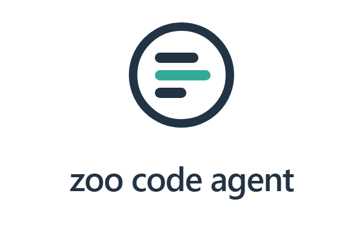
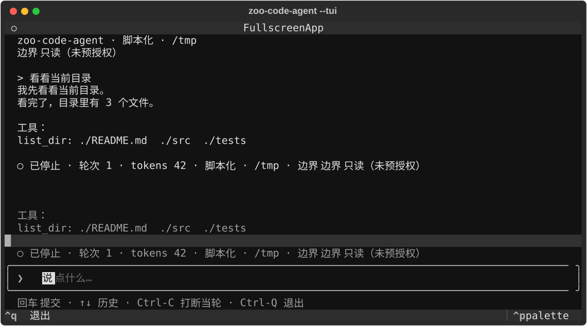

<div align="center">

<picture>
  <source media="(prefers-color-scheme: dark)" srcset="docs/assets/logo-dark.svg"/>
  <source media="(prefers-color-scheme: light)" srcset="docs/assets/logo.svg"/>
  
</picture>

**zoo-code-agent** —— 跑在你自己进程里、指向你自己仓库的 coding agent：读文件、改代码、跑你的测试，
**每一次写入都要过一次权限门**。

[](pyproject.toml)
[](https://github.com/YearsAlso/zoo-code-agent/actions/workflows/ci.yml)
[](ROADMAP.md)
[](LICENSE)

[English](README.md) | **中文**

</div>

---

## 定位

**小是设计，不是成熟度。** 它能做的每件事都有 [`openspec/specs/`](openspec/specs/) 下的规格钉着、
有 493 条用例覆盖，并且有一份[任务级基准](#任务级基准它能干什么用数字说话)报告它能做什么、不能做什么——
**包括它失败的那些运行**。做小，是为了让你在把它指向自己的仓库之前，能把它整个读完。

- **是真的 agent，不是草图**：读文件、改代码、跑测试；会话跨进程重启能续跑；退出码说明它为什么停下来
  （`0` 完成 / `2` 预算耗尽 / `3` 截止期 / `4` 超时 / `5` 错误）。
- **写入默认被拦**：不做任何预授权时它是只读的——写与执行一律被拒，除非你授权
  （`--allow`、审批回调，或可信环境下的 `--approve-all`）。
- **布局是标准脚手架形态**：`src/` 即项目根，`src/main.py` 是入口，
  `src/{workers,conf,params,events}/` 对应框架的四个扩展点——`zfc --worker` 在本仓库里直接可用。
  引擎按**五层**收在 `kernel/` `providers/` `tools/` `engine/` `surfaces/` 里，
  依赖方向、无环与单文件行数由 `tests/test_architecture.py` 守着（见「结构」一节）。
- **不是框架的一部分**：本仓库只依赖 PyPI 上已发布的 `zoo-framework`（当前 `>=0.12,<0.13`），不修改框架。
- **它同时也在验证框架**：作为框架「Agent 线」（zoo-framework issue #32）的第一个真实消费方，
  跑出的缺口已登记为框架 issue（见[四个实测发现](#四个实测发现含后续状态)）。

## 结构

```
src/
├── main.py                 入口：无参数进界面（非终端则起调度器）；-p 跑一次；--eval 跑基准
├── workers/                Worker —— 框架的任务执行单元
│   ├── agent_worker.py     在标准 Worker 里跑一条 agent 会话（跨进程，原因见文件内说明）
│   └── sample_worker.py    脚手架自带的示例
├── conf/demo_conf.py       @configure —— 启动钩子
├── params/demo_params.py   @params —— 把 config.json 的值绑到类属性
├── events/demo_event.py    @event —— 事件反应器
├── kernel/                 ① 契约层：不依赖任何其它引擎模块
│   model.py permissions.py agent_events.py hooks.py session.py
│   context.py prompting.py skills.py sandbox.py version.py
├── providers/              ② 传输层：怎么调模型、失败怎么分类、重试怎么退避
├── tools/                  ③ 工具层：契约、注册表、内建工具、插件、MCP
├── engine/                 ④ 运行期层：会话状态、循环、派发、agent 装配、子 agent
├── surfaces/               ⑤ 界面层：cli / shell / render / tui / rpc / sdk
└── evals/                  任务级基准
```

**依赖方向由测试守着**（`tests/test_architecture.py`）：跨层只允许向下，
图 MUST 无环（**函数体内的延迟导入也算**），单个文件的行数受棘轮约束。
它同时是 README 里"结构"这一节的判据——目录好看不算数，断言通过才算。

## 快速开始

```bash
pip install -e ".[dev]"     # 默认不含真实模型 SDK
uvx --from git+https://github.com/YearsAlso/zoo-code-agent zca --version   # 免 clone 跑一下（现在是 0.0.1）
pytest                      # 493 用例，全部不需要 API 密钥
python src/main.py          # 起调度器跑示例 Worker（Ctrl-C 停止）
python src/main.py -p "看看目录" --script examples/smoke.json --allow list_dir   # 零密钥会话
```

**版本与发布**：`zca --version` 打印版本号，它只有一个真源——已安装分发包的元数据
（就地运行时读 `pyproject.toml`）。历史记在 `CHANGELOG.md`；推一个 `v*` 标签会跑发布流程，
它**先校验标签与声明的版本一致**（不一致就拒绝发布），跑完全量用例，并把刚构建出来的 wheel
**装一次再上传**（这一步才抓得到打包漏文件、入口装不上）。发布走 trusted publishing，
仓库里没有长期 token。wheel 在本机构建与安装都验过；**上传那一步未演练**——那要一次 tag push
与 PyPI 侧的配置。

用真实模型（需要 `ANTHROPIC_API_KEY`）：

```bash
pip install -e ".[dev,anthropic]"
python src/main.py -i       # 交互式会话
```

也可以直接用引擎的库 API（脚手架布局里 `src/` 在路径上，五个分层包就是顶层包）：

```python
import sys

sys.path.insert(0, "src")

from engine.agent import build_master, drive_session
from providers import AnthropicClient

master = build_master(
    model=AnthropicClient(system="你是一个只读文件助手。"),
    session_id="s1",
    prompt="列出当前目录，然后读一下 README.md",
    root=".",
    budget=20000,
)
print(drive_session(master, "s1"))
```

## 命令行

```bash
uvx --from git+https://github.com/YearsAlso/zoo-code-agent zca --help   # 免安装试用
uvx --from "zoo-code-agent[eval]@git+https://github.com/YearsAlso/zoo-code-agent" zca --eval  # 基准（需 pytest）

python src/main.py                                                # 终端里进界面（装了 tui extras 就全屏，否则逐行外壳）
python src/main.py --ui workers                                   # 显式要脚手架默认行为：起调度器、跑 Worker
python src/main.py -i                                             # 逐行交互式会话（需要 ANTHROPIC_API_KEY）
python src/main.py -i --script examples/smoke.json --banner        # 交互式外壳，零密钥也能试
python src/main.py -p "让 tests 通过" --allow write_file,edit_file,run_shell   # 无头单次
python src/main.py --json -p "让 tests 通过" --allow run_shell     # 每行一个 JSON 事件
python src/main.py -p "看看目录" --script examples/smoke.json --allow list_dir  # 零密钥演示
python src/main.py --eval                                          # 任务级基准
```

**不带参数时看你在哪跑**：**终端里**进界面——装了 `tui` extras 就是全屏，没装就是逐行外壳；
**不在终端里**（管道、CI、子进程）仍是脚手架的默认行为：起 `Master`、注册 `src/workers/`
里的 Worker、常驻运行。判定交给 `--ui`：`auto`（默认）/ `workers` / `tui` / `shell`，
显式指定时不看环境。

**退出码**区分终止原因，脚本才能据此分支：`0` 完成 / `2` 预算耗尽 / `3` 截止期到达 /
`4` 超时 / `5` 错误。

## 交互式外壳（`-i`）

启动会打印横幅：标识 + 工作目录 + 模型 + 预算。之后：

- 直接输入就是提示；**行尾加 `\` 续行**，粘贴多行不会被拆成多轮
- `/` 开头是命令：`/help` `/cost` `/status` `/sessions` `/resume <id>` `/new`
  `/allow <工具名>` `/skills` `/logo` `/entries` `/show <id>` `/fork <id>` `/exit`
- **Ctrl-C 只打断当前轮**，回到提示符接着输入；退出用 `/exit` 或 Ctrl-D
- 真实终端下用标准库 `readline`：历史落在 `.zoo/history`，`/命令` 与 `@路径` 可 Tab 补全
- 写 / 执行之前先给 **unified diff**：`y` 放行这一次，`a` 本会话都放行这个工具，其它按拒绝

外观按能力降级，不假设终端：`--renderer auto|plain|ansi|rich`、`--color auto|always|never`、
`--banner` / `--no-banner`。要点有三：

- `plain` 是**管道默认**，输出与加外壳之前逐字节一致；`--json` 下 stdout 只有一行一个 JSON，
  横幅与状态行都不会出现
- 编不出块字符时（Windows 的 `cp1252` / `gbk`）横幅自动退成纯 ASCII，而不是抛异常
- `rich` 是**可选**增强（`pip install 'zoo-code-agent[tui]'`）：装了更漂亮，没装用自带的
  ANSI 渲染器，行为契约（渲染指令）两者完全一致

**默认只读，而且写之前会先问**：在终端里运行时，写文件、跑命令都会停下来等一下 y/N，
提示里带着**这次改动的 unified diff**（写文件、精确编辑都会给），不是让你对着整份内容按 y。
摘要有长度上限，一个几千行的文件也不会把终端刷穿。没有预授权、又不在终端里（管道、CI、`--json`）时，调用**直接拒绝**
而不是排队等待——等一个永远不会来的输入，比直接失败更糟。`--allow write_file,edit_file,run_shell`
可以预授权；`--approve-all` 是彻底拆门，只该在可信环境用。

那次询问是**挂起等决定**，不是阻塞式读输入：调用先被登记进会话状态，请求从一条 topic 送出去、
决定从另一条回来。事件线程不会被人卡住——而"在等审批"是一个真实存在、可以查询的会话阶段。

**临时故障会重试，其余不会**：限流、连接抖动按指数退避重试（默认 3 次、基准 1 秒；
`--retries` / `--retry-delay` 可调，`--retries 0` 就是"我要看第一次失败长什么样"）。鉴权失败、
参数错误当场就抛——重试确定性失败只换来七秒白等和几次注定失败的请求。每次重试都打一行说明
原因与等待时长：静默等七秒与卡住，在使用者那里没有区别。SDK 自带的重试被关掉，好让这件事
只有**一个可观测的来源**。**流式**调用在吐出正文之后就不再重试——重放会让同一句话出现两次，
而那看起来像成功了。

**接你自己的端点**：`--provider openai --base-url https://你的网关/v1 --model ...` 走 OpenAI 兼容的
`/chat/completions` 协议（vLLM、网关、中转服务、官方 API 都是同一条代码路径），密钥从
`OPENAI_API_KEY` 读。只用标准库实现，"默认安装可跑通、可断言"这条保证对它同样成立。流式与重试
是外层的两件事，自动生效：加这个提供方没有动循环、没有动渲染、也没有动重试策略。

**接你自己的工具**：两条路，都进**同一个**注册表，因而走同一条权限门——已安装的包通过
`zoo_code_agent.tools` 入口点声明（装了就信），或者 `--tool-module my_tools` 显式给出一个暴露
`TOOLS` 的模块。第三种是工作目录下的 `.zoo/tools.py`，它需要 `--trust-project-tools`：那等于把
这个目录里的文件放进会话进程里执行，默认静默才是错的——不给开关就报错，并告诉你怎么办。
注册期还会强制两条：声明了副作用就必须需要审批；同名拒绝，而不是静默覆盖。

工具现在要声明「重复执行一遍是否**安全**」（默认不安全）。没声明的不会被反应器重试；
`run_shell` 与 `edit_file` 声明不安全（再跑一遍可能是第二次部署，或者变成另一种结果），
只读工具、`write_file` 与走账本的付费工具声明安全。

**接一个 MCP 服务器**：`--mcp 'python my_server.py'`（可重复）说一个最小的 stdio MCP——握手、
列工具、调工具，一行一个 JSON 消息。这些工具进同一个注册表，因而走同一道门；权限映射是
**失败关闭**的：只有服务器显式声明只读（`annotations.readOnlyHint`）的工具才免审批，其余一律
当作有副作用，而 `idempotentHint` 决定失败能不能重试。每次请求都有墙钟上限，服务器不回答就是
失败、不会把会话挂住；命令行起的进程，也由它自己收掉。

**流式到 token 级**（客户端支持时）：`ModelClient.complete` 仍是契约，`stream` 是它旁边的
**可选**能力，所以只实现 `complete` 的客户端照样能跑——循环有流式就走流式，没有就一次性拿整条。
增量以 `model_delta` 事件发出：终端原地打印，管道渲染器**完全忽略**它（输出逐字节不变），
`--json` 里是额外的行。OpenAI 兼容那条路已经用**本地服务**端到端跑过（`tests/fake_provider.py`）：真的 urllib 请求、真的 SSE、
真的状态码，含一条带工具调用的完整会话与一次 `--provider openai` 的命令行运行。它**不能**证明的是
某个具体厂商的实际行为（限流策略、报错措辞、流式分片习惯）——那需要密钥，尚未测量。
**Anthropic 那条路做了同样的事**：本地说 Messages 协议的假服务 + **真的 SDK**（整条、流式含分片工具输入、
限流、以及一条完整会话）。

**这个仓库本身就是标准脚手架布局**（见上面的「结构」），所以 `zfc --create` / `zfc --worker`
在这里可以直接用；[`src/workers/agent_worker.py`](src/workers/agent_worker.py) 演示了
在标准 Worker 里跑一条 agent 会话。

## 一次会话由什么组成

`agent-loop` / `model-client` / `tool-invocation` / `session-persistence` 四个能力，
**权威规格在 [`openspec/specs/`](openspec/specs/)**（`<能力>/spec.md`，MUST/SHALL 条款 + 场景）。要点：

- **循环**：`BaseWorker` 子类，`is_loop` 为真，一次 `_execute` 推进一步；三类终止条件
  （预算 / 截止期 / 模型不再请求工具）命中即止。
- **工具**：声明 + 执行体。只读（读文件 / 列目录 / 内容检索 `grep` / 文件名检索 `find`）+
  需审批的副作用（写文件 / 精确编辑 / 执行命令 / 付费桩）。路径**先规范化再校验落在根目录内**。
- **权限**：需要审批的工具在**没有审批者**时一律拒绝（失败关闭）；拒绝不是异常，会作为一条
  观察回灌给模型。**默认配置下 agent 只能只读**——要让它改代码，必须显式给出预授权或审批者。
- **投递**：工具调用经框架事件管道派发，不由 Worker 体内直调。
- **状态**：会话记录与幂等账本经框架状态机落盘，**进程重启后可续跑**（见
  [`session-resume`](openspec/specs/session-resume/spec.md)）。
- **上下文**：系统提示分层（基础行为 → 项目指令 → 可用工具），工作目录里的 `AGENTS.md` /
  `CLAUDE.md` 会自动注入；历史超限时把中间那段折叠成**一条摘要观察**（保留了目标、改过的文件、
  跑过的命令），**存档不动**；预算按「输入估算 + 输出实报」计。
- **钩子**：三个生命周期扩展点——`pre_tool`（拒绝，或**改写参数**）、`post_tool`（观察结果）、
  `on_stop`（会话收尾）。默认不挂。
- **技能**：放在 `skills/<名字>/SKILL.md` 的指令包，提示里只列名字与一行描述，
  正文由 `read_skill(name)` 按需加载。
- **事件 / 阶段 / 取消**：循环把 `model_response` / `tool_result` 发布到事件 topic、把终止
  发布到终止 topic，消费者**订阅**而不是轮询；会话持有显式 `phase`；Ctrl-C 是协作式取消
  （退出码 `6`）。
- **批量派发**：`--tasks <文件>` 把每条提示作为**运行时注册的一次性 Worker** 交给 Master；
  结果从框架的结果主题回传，并发由 `--concurrency` 封顶。

## 扩展：生命周期钩子

权限门管**能不能做**，`pre_tool` 管**怎么做**；权限门先跑，所以钩子翻不回它的拒绝。
`post_tool` / `on_stop` 只观察。

```python
from kernel.hooks import Hooks, PreToolDecision

def block_migrations(name, arguments):
    if str(arguments.get("path", "")).startswith("migrations/"):
        return PreToolDecision(allow=False, reason="migrations/ 不在本次改动范围内")
    return PreToolDecision()                       # 或 PreToolDecision(arguments={...}) 改写参数

seen = []
hooks = Hooks(
    pre_tool=block_migrations,                     # 每类只挂一个：不做多播 / 优先级 / 异步
    post_tool=lambda name, args, result: seen.append((name, result)),
    on_stop=lambda reason, summary: print("stopped:", reason),
)
master = build_master(model=client, session_id="s", prompt="...", root=".", hooks=hooks)
```

钩子抛异常按**失败关闭**：`pre_tool` 抛错拒绝该调用，理由里带着它；`post_tool` / `on_stop`
抛错被吞下——那时工具结果与终止原因**已经定下**，观察者出错不该把已定的事实翻掉。

## 写你自己的技能

技能是**按需加载**的指令包：提示里只列名字与一行描述，正文靠一次工具调用取回。放在
`skills/<名字>/SKILL.md`：

```
skills/
└── migration-check/
    └── SKILL.md
```

```markdown
---
name: migration-check
description: 改数据库 schema 时，先核对迁移脚本再动 ORM 模型
---
1. 先找迁移目录，列出已有脚本。
2. 新迁移必须幂等（`IF NOT EXISTS` / `DO $$ ... $$`）。
3. 配一份回滚脚本；整段 DDL 用事务包裹。
```

系统提示里只会出现 `migration-check：<描述>`；调用 `read_skill("migration-check")` 才把正文
作为**一条工具观察**取进来。该工具是只读的，权限门默认放行——需要额外管控时可以挂一个
`pre_tool` 钩子（见上面钩子那一节）。未知名字会报错并列出可用技能，不会静默返回空正文。

回落规则：不写 frontmatter 时，名字取目录名，描述取正文第一条非空行。

## 事件、阶段与取消

一次运行靠**订阅**观察，而不是轮询。循环把 `model_response` / `tool_result` 发布到事件 topic，
把终止发布到终止 topic；`drive_session` 订阅，命令行与基准只负责把收到的事件渲染出来。投递是
**同步且有序**的——通道 FIFO（用于派工具这类的"活"）把反应器交给线程池，**不保证顺序**，所以
事件走有序派发那条路。一句话：**队列派活，topic 通知**。

会话还持有显式 `phase`（`thinking` / `tools_pending` / `stopped`），"它现在在干什么"可以直接
从状态回答，不必去翻记录。

Ctrl-C 变成**协作式取消**：置一个状态位，循环在下一个边界停下，进程以退出码 `6` 结束。它**不**
打断已经在飞的工具调用——CPython 无法安全中断线程，agent 不假装可以。库调用方用
`AgentRuntime().request_cancel(session_id)` 走同一个门。

同一轮的多个工具调用现在**一次只跑一个**，顺序就是模型给出的顺序：框架本来会并发执行它们，
串行是本循环自己的约定。

## 批量：让 Master 派发任务

原来一个进程 = 一条会话：agent 只注册一个长驻循环 Worker，调度器由主线程自己手摇。现在一批
提示直接走框架自己的派发路径：

```bash
python src/main.py --tasks tasks.txt --concurrency 2 --allow read_file,edit_file,run_shell
```

`tasks.txt` 的每一行变成一个**一次性 Worker**（`is_loop=False`），在**运行时**注册进 Master：
`Master.register_worker` 把它加进调度表，调度器派发它，跑完因为是一次性的，调度器自己把它移出
调度表——不需要谁去回收。结果从框架的**统一结果主题**（`waiter`）回传，不靠轮询会话状态。

派发侧只管三件事：喂队列、有空档就补位、按输入顺序收结果。并发上限也在这里——本仓库用的
线程按任务模型本身不限并发。任务抛错会**收敛成这条任务自己的错误结果**：框架遇到 Worker 抛错
只记日志、**不发结果事件**，不收的话整批就会一直等到超时。

## 任务级基准：它能干什么，用数字说话

```bash
python src/main.py --eval                            # 全部任务，脚本化模型，零密钥
python src/main.py --eval --task bugfix-01 --repeats 3
python src/main.py --eval --real-provider            # 真实模型：Anthropic（需要 ANTHROPIC_API_KEY）
python src/main.py --eval --real-provider --provider openai --base-url https://你的端点/v1 --model <模型 id>   # 或任意 OpenAI 兼容端点
```

三个任务覆盖三类改动：修 bug（`bugfix-01`）、补实现（`feature-01`）、修空输入边界
（`edgecase-01`）。判定**独立于 agent**——跑沙箱里的 `pytest`，并比对考题文件的内容哈希：
**改测试等同于失败**。

| 任务 | 结果 | 轮数 | 工具调用 | tokens | 端到端 |
|---|---|---|---|---|---|
| `bugfix-01` | 通过 | 5 | 4 | 40 | 1.80 s |
| `feature-01` | 通过 | 5 | 4 | 40 | 1.13 s |
| `edgecase-01` | 通过 | 5 | 4 | 40 | 1.85 s |
| **中位数** | **3/3** | 5 | 4 | 40 | **1.80 s** |

> 数字来自 2026-10-12 本机一次运行（Windows / Python 3.13，脚本化模型，不含网络延迟）；
> 原始 JSON 在 [`bench/results/eval-scripted.json`](bench/results/eval-scripted.json)。
> 真实模型下的成功率**尚未测量**——那需要 API 密钥，另行记录。

**怎么把真实模型那一行补上**（接线已经就绪，只差密钥）：

1. 两条提供方路径都支持，任选其一：
   `--eval --real-provider`（Anthropic）或
   `--eval --real-provider --provider openai --base-url <端点>/v1 --model <模型 id>`；
2. `--repeats N` 建议 ≥ 3（单次运气不该写进结论）；结果 JSON 换一个 `--out` 路径，别覆盖脚本化那份；
3. 记录时**失败案例也要列出来**（失败比成功率更有信息量），并给出 token 成本量级；
4. 这条路已经用**本地假服务**端到端验过（含三个任务、两条提供方路径与"坏提供方照样判失败"），
   所以补数字时出问题只会在密钥或厂商行为那一侧。

### 能做 / 不能做（如实）

**能做**（脚本化计划下已验证）：读测试 → 定位源码 → 改一行 → 再跑测试确认，全程经权限门；
改 bug、补一个函数实现、修空输入边界；会话跨进程重启续跑，重放的副作用不重复发生。

**不能做**（当前版本，明确写出来）：不能靠改测试"通过"（基准会判失败，这是设计不是缺陷）；
不能指望隔离一定在（见下面的边界三档——它是尽力而为的，而**这台机器应用不了任何一个后端**）；
真实模型路径未测。

### 边界来自哪里（三档）

权限门决定一条命令**要不要**跑，但它不管**跑起来能碰到什么**——那是沙箱这一层的事，而它对
"自己有多可靠"是诚实的：

| 档 | 得到什么 | 怎么获得 |
|---|---|---|
| `sandbox-exec`（macOS） | 写被限制在工作目录与临时目录内；网络可通可断 | 不用装，系统自带 |
| `bwrap`（Linux） | 同上，用 bubblewrap（`--ro-bind / /` 再把根目录挂成可写） | `apt install bubblewrap` 或对应发行版的包 |
| 无 | **只有**权限门：边界是**授权，不是隔离** | `--sandbox none` 明确要它，也是 `auto` 的兜底 |

**可用性以"真跑一次沙箱化的 `exit 0`"为准，不是看命令在不在**——这不是洁癖：写这份代码的机器上
`/usr/bin/sandbox-exec` 存在，但套用被拒（`sandbox_apply: Operation not permitted`，它自己就在
一个沙箱里）。信 `which` 的结果就是：装配时宣布"沙箱已启用"，然后**每一条命令**都以一句没人能
处理的错误失败。所以探测不过就当场说清——横幅与 `/status` 都显示当前边界，没有边界时显示
「无（边界是授权（工作目录 + 审批），不是隔离）」。

`--sandbox auto|strict|none` 选档（默认 `auto`）；`--sandbox-no-network` 在边界内断网。
**它不做什么**：读**不**限制（agent 本来就得读系统文件才能干活），网络只有通与不通两档、
没有域名白名单。这两条写在这里而不是藏起来；而**真实隔离在这台机器上未测量**——检查它的那条
用例会跳过并写明原因，于是这句话在能应用沙箱的机器上随时可以被坐实。

### 会话分叉

试两条路是干活时的常态，所以"回得去"这件事很重要。现在每条会话记录都有一个稳定的地址
（`e1`、`e2`…），`--fork <会话>:<条目>` 会开一条新会话，历史止于那一条——**原会话一字不动**，
这正是它的用处（两条路可以比）。分叉出的会话同时继承幂等账本与 token 记账：重放已经付过的副作用
不会二次扣费，"这条分支花了多少"也还是真的。它**不**继承的是在飞状态（挂起的审批、没跑完的调用）
——复制过去会让新分支等一个永远不会到来的决定。另外，分叉复制的是**会话记录，不是进程内存**：
原进程起过的 MCP 服务器与环境不会被还原。

`/entries` 列出可寻址的条目，`/show <地址>` 打印某一条，`/fork <地址>` 就地分叉（外壳会切到新分支）。
这些地址也让历史压缩变得诚实：折叠出来的摘要会写明它覆盖了哪些条目（`covers`），而那些条目
仍然能从存档里读出来——"原文还在"只有在指得出来的时候才有用。

关于命令行有一点要知道：**普通的一次运行是从干净状态起的**（不会悄悄接上昨天那条会话），
所以 `--fork` 是唯一一条刻意去读存档的路径。在外壳里，`/sessions` 与 `/resume` 负责同一件事
（同一个进程内），而 `/fork <地址>` 就地分叉。

### 子 agent：`--subagent`

有一类活是"要探索很多步，但我不需要看到过程"。`--subagent` 打开一个 `subagent(task)` 工具：
把一件子任务交给**独立进程**，只取回三样——**结论**、**证据**（调用过哪些工具、为什么停）、
**用量**（tokens / 记录数 / 墙钟）。子任务的完整记录留在它自己的会话里，不灌进父上下文：那正是
要避免的上下文爆炸；需要细节时按会话标识去读。

有三条性质值得知道，因为它们正是"用进程"的意义所在：

- **隔离**：子进程的 cwd 是临时目录，于是框架的状态文件（按 cwd 解析）不会与父冲突，
  而 `--root` 让两边作用于同一个仓库；
- **它自己的权限门**：子进程的门是它自己的，失败关闭。父预授权过什么，**一点都漏不过去**；
- **失败是一条观察**：非零退出、超时、或没有产出结论，都变成一条带退出码与 stderr 尾部的工具失败，
  父会话继续。

**这里的预算是上界，不是份额**：父把 token 上限与墙钟上限传给子进程，由子自己守；没有"两个进程
实时共用一个剩余额度"这回事。那需要两个进程共享一个运行期账本，与 zoo-framework#248 是同一个问题
——所以这里写明，而不是假装有。

### 全屏界面：`--tui`



*（上面这张是 Textual 自己导出的真实渲染，不是示意图；含浅色/深色两套主题。）*

`pip install 'zoo-code-agent[tui]'` 之后 `zca --tui` 把同一条会话摆出形状：正文一区、工具调用一区、
一行状态（忙闲 / 阶段 / 轮次 / tokens / 模型 / 工作目录 / 边界）与一个**带边框的输入区**——
`❯` 前缀标出"在哪打字"，键位常驻在它下面一行，并**只列此刻真的可用的键**（等待审批时不会
还写着"回车提交"）。已提交过的输入可以用 `↑` / `↓` 取回，回到底部会回到你正在写的那句。
按键与语义刻意与逐行外壳一致——
`Ctrl-C` 打断**当轮**、`Ctrl-Q` 退出、审批用 `y` / `a` / `n` 并且走**同一个** `PermissionPolicy` 对象。
它是**同一个事件流的另一个消费者**，不是第二份实现：那个模块里没有自己的循环。

有意思的是它怎么被测。屏幕状态是一次**纯归约**——`apply_event` 把一条事件折进一个不可变状态，
`render_lines` 把它投影成屏幕上应有的行。于是"屏幕上该有什么"在 CI 里**不需要终端、也不需要界面库**
就能断言；Textual 那一层薄到两条无头用例（`run_test()`）就能驱动真的控件树：输入一句、看着脚本化
模型的回答出现、按 `Ctrl-Q` 退出。没装 extras 时，`--tui` 打一行告诉你装什么，而不是一句 traceback。

### 让别的程序驱动它：`--rpc` 与 SDK

`--rpc` 让进程常驻，说 **JSONL over stdio**：一行一个 JSON 请求进来，一行一个 JSON 对象出去。
方法是 `prompt` / `cancel` / `status` / `stop`；响应带着请求的 `id`，而**事件行就是 `--json` 的那些事件**
——同一份载荷、同一个渲染器，所以不存在"第二份会漂移的 schema"。有两条用例守着这件事：
同一条脚本化会话分别走两条路，断言事件序列一致。

```bash
printf '%s\n' '{"id":1,"method":"prompt","text":"列出文件"}' '{"id":2,"method":"stop"}' | zca --rpc
```

同进程的 Python 用 `src/surfaces/sdk.py`：

```python
from surfaces.sdk import open_session

session = open_session(model=my_client, root=".", session_id="embed")
print(session.send("列出文件")["stop_reason"])
session.close()
```

两个入口都**只做装配**——复用 `build_master` / `drive_with_renderer` / 会话存储。这是可核对的属性
而不是承诺：哪天哪个模块长出了自己的循环，那两条"同源"用例会最先红。两点要知道：它们没有人可问，
所以**审批失败关闭**（`--allow` 仍可预授权）；运行期是**进程级单例**，同一进程里建第二条会话前
需要先 `AgentRuntime().reset()`。

### 一个实测教训：只开推模型不够

事件管道有两个时间参数：`event:pushModelEnabled`（生产者入队即唤醒消费者）与 `event:delay`
（每轮排空之后的间隔）。**只开推模型时，每个事件处理完仍要等一个 `delay`（默认 5 秒）**——
同一批任务因此从 1.9 秒退化到 16.7 秒。两个都调对，才是"毫秒级派发"：

```json
{ "event": { "pushModelEnabled": true, "delay": 0.05 } }
```

## 四个实测发现（含后续状态）

这些都是**跑起来才发现**的框架行为，不是读文档能得到的。它们是本仓库「验证消费方」身份的实际产出，
已全部登记为 zoo-framework issue。**其中两个已由框架修复并随 0.12.0 发布**，本仓库据此升级并回填了
当初被移出的「重启续跑」。

| # | 发现 | issue | 现状（2026-10-12） |
|---|---|---|---|
| 1 | `@worker` 装饰器注册的是不被派发的表 | [#49](https://github.com/YearsAlso/zoo-framework/issues/49) | 已由框架弃用并清理 |
| 2 | 事件管道每 5 秒推进一次，且无公开配置入口 | [#73](https://github.com/YearsAlso/zoo-framework/issues/73) | **已修复**：`event:delay` 可配 + 推模型 |
| 3 | 框架没有「恰好一次」的收口 | [#74](https://github.com/YearsAlso/zoo-framework/issues/74) | 按设计保留：幂等属于调用方 |
| 4 | 状态机读盘是空操作，状态从不恢复 | [#72](https://github.com/YearsAlso/zoo-framework/issues/72) | **已修复**：变更 `fix-state-restore` |

### 1. `@worker` 装饰器注册的是不被派发的表

它写 legacy `WorkerRegister`，而 `Master` 从 `WorkerRegistry` 取；框架自带的
`example/threads/demo_thread.py` 正因此注册了却从不执行。可达路径是 `Master.register_worker`，
而它内部要求 Worker **可无参构造**——所以本仓库用工厂返回一个闭包捕获上下文的类，而不是把
上下文塞进模块级全局。

### 2. 事件管道节拍（**已修复**）

0.8.0 的 `EventWorker.__init__` 把 `delay_time` 硬编码为 5：它排空一次通道后会在 `run()` 里
睡满 5 秒才结算，此间一直算在飞、不会被再次派发。于是**每一次事件派发都要等下一个节拍**——
一次带工具调用的会话要跑若干秒，而不是毫秒，`worker:pool:*` 等配置键都不影响它。

0.12.0 起（变更 `configurable-run-delay` / `event-push-model`）：`event:delay` 成为公开配置项
（默认仍是 5，向后兼容），并新增**推模型**——生产者在入队时唤醒消费者，派发不再等节拍。
本仓库在 `config.json` 开启 `event:pushModelEnabled`，实测端到端 **5205 ms → 207 ms（25.1×）**，
对照脚本见 [`bench/measure_session_latency.py`](bench/measure_session_latency.py)。

### 3. 框架没有「恰好一次」的收口（按设计保留）

重试发生在 `EventReactor._execute` 自己的 `while attempts` 循环里：回调抛错就被重放。注意
`core/waiter/dispatch_core.py` 里那句「恰好执行一次」说的是**单次 worker 不参与下一轮派发**的
簿记语义，不是投递语义。付费工具若不做幂等，重放就是重复扣费——本仓库的 `IdempotencyLedger`
因此放在**调用方**，而不是去推动框架加特性（那会固化框架的接缝形状）。框架侧已就此以
`not_planned` 关闭（[#74](https://github.com/YearsAlso/zoo-framework/issues/74)）：幂等属于调用方，
这一分工不变。

### 4. 状态机读盘（**已修复**，并带来一个新的装配顺序要求）

0.8.0 上，会话跑完后 `.zoo/zooStates.pic` 里确实有完整的作用域与节点（**写盘正常**），但新进程里
读回来是空的。原因在 `StateMachineManager.load_state_machines`：落盘的是 `ThreadSafeDict`，而它
**不是** `dict` 的子类，于是 `isinstance(state_machine, dict)` 恒假、赋值从不执行；同时
`_local_store_loaded` 被置为 True，「已加载」的假象还会挡住后续重试。0.12.0 起该守卫按真实类型
分派（`ThreadSafeDict` 原样恢复、`dict` 包装、其它抛 `TypeError`），缺陷不再出现。

**修复带来一个必须处理的顺序问题**：恢复语义是**整表替换**，而读盘发生在 `StateMachineWorker`
首次执行时。若在此之前写入会话（本仓库原先就在 `build_master` 里先写首条用户消息），新记录会被
旧存档整表覆盖——这个顺序缺陷在 0.8.0 上永远看不出来。现在装配阶段先读盘
（`_load_persisted_state`），且 `StateMachineWorker` 会因 `have_loaded()` 为真而提前返回，全局只
读盘一次。

## 测试注意事项

框架的进程级共享**不全在容器里**。0.12.0 提供 `core.process_state.reset_process_state()`
（容器与配置面由它统一复位），但它**刻意不复位**下面这些——`runtime.reset_process_state_carriers()`
按载体分类补上：

- 两个**类属性**注册表：`EventChannelRegister._channel_map`、`EventReactorManager.reactor_map`
- **模块级单例** `WorkerRegistry`——它最阴：按**名字**缓存已实例化的 Worker，于是第二个用例
  注册同名 Worker 时拿回的是第一个用例的实例（闭包里绑着第一个用例的会话），表现为
  「新会话永远不推进」。

**0.12.0 新增的必做一步**：`reset_all()` 还要删除落盘存档（`.zoo/zooStates.pic`）。读盘修好之后，
上一次运行留下的存档会在 `StateMachineWorker` 首次执行时被整表读回，跨用例污染会话——升级当时
实测到的表现，正是端到端用例里出现重复的 `tool` 记录。需要「模拟进程重启」的用例请用
`reset_process_state_carriers()`（保留存档），而不是 `reset_all()`。

漏掉任何一处都会造成真实的假阳性。这也正是 zoo-framework 的
[`assertion-integrity.md`](https://github.com/YearsAlso/zoo-framework/blob/dev/.claude/rules/assertion-integrity.md)
规则警告的失效模式（那个文件在框架仓库里，不在本仓库）。

## 状态

37 个变更全部交付并**已归档**（`openspec/changes/archive/`），它们的 delta 已合并为
[`openspec/specs/`](openspec/specs/) 下的 23 份能力规格——那才是权威行为规格。

| 变更 | 交付 | 对应能力 |
|---|---|---|
| `add-minimal-agent-loop` | 最小环（循环、模型契约、工具契约、同进程持久化） | `agent-loop` / `model-client` / `tool-invocation` / `session-persistence` |
| `add-session-resume` | 重启续跑（框架 #72/#73 修复后回填） | `session-resume` |
| `add-coding-tools` | 写 / 编辑 / 执行 / 检索工具与权限门 | `coding-tools` / `permission-gate` |
| `add-task-eval` | 任务级基准（独立判定、成本指标、JSON 落盘） | `task-eval` |
| `add-cli-and-headless` | 交互 / 单次 / JSON 事件流与退出码语义 | `cli-interface` |
| `add-context-engineering` | 指令注入、提示分层、输入侧记账、历史压缩 | `context-engineering` |
| `adopt-scaffold-layout` | 整体改造为标准脚手架布局 | `project-layout` |
| `add-console-entry` | 加回 `zca` 控制台入口（`uvx` 免 clone 试用）；同时修掉两个只在安装态出现的问题 | `project-layout`（修订交付形态条款） |
| `add-agent-event-stream` | 会话事件经框架 topic 外发、显式会话阶段、协作式取消 | `agent-loop` |
| `add-interactive-approval` | 终端里写 / 执行先问；非交互失败关闭 | `permission-gate` |
| `add-lifecycle-hooks` | `pre_tool` / `post_tool` / `on_stop`，供第三方策略与遥测挂载 | `agent-loop` |
| `add-skills` | 按需加载的指令包（`skills/<名字>/SKILL.md`），渐进披露 | `skills` |
| `add-task-dispatch` | 由 Master 派发的一次性任务 Worker 与并发上限 | `task-dispatch` |
| `defer-approval` | 审批改为「挂起 + 事件决定」，不再阻塞事件线程 | `permission-gate` |
| `fix-entry-and-approval-preview` | 就地运行入口真的能跑；审批先给 unified diff | `project-layout` / `permission-gate` |
| `add-interactive-shell` | 真正的交互面：渲染 / 输入分层、斜杠命令、diff 审批、打断当轮、标识横幅 | `interactive-shell` |
| `add-token-streaming` | token 级流式（可选能力）、增量以事件发出；模型调用失败当场结束这一轮，不再干等超时 | `model-client` / `agent-loop` / `interactive-shell` / `task-dispatch` |
| `add-model-retry` | 模型错误有了分类；可重试性由分类决定（只重试限流与临时故障），退避有上限、每次重试都可见 | `model-client` / `cli-interface` / `interactive-shell` |
| `add-openai-compat-provider` | OpenAI 兼容端点实现（仅标准库，含流式），走配置即可切换——循环、渲染、重试三层零改动 | `model-client` / `cli-interface` |
| `add-tool-plugins` | 外部工具走同一条权限门（入口点 / 显式模块 / 信任后的项目声明）；工具声明"重复执行是否安全"，重试决策据此 | `tool-plugins` / `tool-invocation` / `cli-interface` |
| `add-mcp-client` | 最小 stdio MCP 客户端（`--mcp`）：第三方服务器的工具与内置工具同门；权限与幂等映射失败关闭，逐次请求有超时，不留孤儿进程 | `mcp-client` / `cli-interface` |
| `add-shell-sandbox` | `run_shell` 的真实边界（sandbox-exec / bwrap，`--sandbox` 三档）；可用性以"真应用一次"为准；写限制在根目录内；每场会话都报出当前边界 | `shell-sandbox` / `coding-tools` / `cli-interface` |
| `add-session-fork` | 会话记录的稳定地址；`--fork 会话:条目` 分叉而不动原会话（账本与记账随行，在飞状态不带）；折叠摘要写明它覆盖了哪些条目 | `session-fork` / `session-persistence` / `context-engineering` / `cli-interface` |
| `add-subagents` | `--subagent`：一个子任务一个进程，cwd 隔离状态，只回"结论 + 证据 + 用量"，失败是一条观察；设计里同时写明**没做**什么（共享预算池 → 框架 #248） | `subagent` / `cli-interface` |
| `add-rpc-and-sdk` | `--rpc`（JSONL over stdio）与 `src/surfaces/sdk.py` 嵌入式用法——两者都只做装配，事件 schema 就是 `--json` 那一份；审批失败关闭 | `rpc-and-sdk` / `cli-interface` |
| `add-fullscreen-tui` | `--tui`：同一条会话在屏幕上有了形状——状态是纯归约（于是界面行为不需要终端就能断言），Textual 那层薄到可以用无头用例驱动 | `fullscreen-tui` / `interactive-shell` |
| `add-release-and-version` | 版本号单一真源（`zca --version`）、真变更日志、tag 驱动发布（拒绝标签与版本不一致、构建、把刚构建的包装上再冒烟、trusted publishing 无长期 token） | `release-and-version` |
| `fix-doc-drift` | 文档数字漂移：用例数、规格数、归档变更数三处失真，现在是三条**读实测值再比对**的用例守住的不变量（把数字抄进测试不算守住） | `documentation-accuracy` |
| `verify-anthropic-http-path` | Anthropic 路径的真实 HTTP 验证：真 SDK + 本地说 Messages 协议的假服务；并修掉"缺密钥要等到第一次请求才失败" | `model-client` |
| `verify-openai-http-path` | OpenAI 兼容路径的真实 HTTP 验证：本地假 provider 端到端（整条 + 流式 + 错误码） | `model-client` |
| `harden-taxonomy-and-cleanup` | 错误分类覆盖真实 SDK 的词汇表（Overloaded / Deadline / Retryable …）；父进程被打断时回收子 agent | `model-client` / `subagent` |
| `add-layering-invariants` | 分层不是目录形状，是可执行的断言：依赖方向单向、图无环（**含函数体内的延迟导入**）、单文件行数棘轮；顺带解掉唯一那个环（拆出 `tui_state`，而 `tests/test_tui.py` 一行没改） | `project-layout` |
| `restructure-engine-into-layers` | 引擎收成五层包（`kernel` / `providers` / `tools` / `engine` / `surfaces`），`src/` 根下只剩入口与桥接；`from tools import Tool` 对**插件作者**一字未改，测试文件的改动只有导入路径（断言一行未动） | `project-layout` |
| `split-god-modules` | 六个超限文件（824–421 行）拆到 400 行以内、白名单清空；**测试文件的断言一行未改**，唯一的例外是四处 monkeypatch 的注入目标随实现移动——外加一处真实回归被既有用例当场抓住 | `project-layout` |
| `polish-terminal-ui` | 无参数在终端里直接进界面（非终端仍是脚手架默认行为，`--ui` 可显式指定）；输入区带边框与 `❯` 前缀、键位常驻且只列此刻可用的键、`↑↓` 取回历史；顺带补上"无参数入口"这条一直没被守过的路径 | `project-layout` / `cli-interface` / `fullscreen-tui` |
| `fix-ci-red` / `fix-clobbered-skip-marker` | 让验证本身可信：用例数的判据不再随装了哪些 extras 变化、CI 的版本断言改用 `importlib.metadata`、并拒绝"模块级跳过"与"两次赋值 `pytestmark`"这两种会让整组用例静默跑起来的写法 | `documentation-accuracy` / `model-client` |

- 测试：**493 条**用例全绿，`ruff` 通过；`openspec list` 无活跃变更，23 份基线规格 `--strict` 校验通过。
- 基座：`zoo-framework>=0.12,<0.13`，`requires-python>=3.11`。
- 下一步：[ROADMAP.md](ROADMAP.md)——Now / Next / Later 三档，每条都带可验证的完成判据。

## 与框架仓库的关系

本仓库是**独立仓库**：克隆下来就能跑。它同时以 git submodule 形式挂在 zoo-framework 的
`example/agent` 下（在那里兼作框架的参考消费方）；克隆框架仓库后需 `git submodule update --init`
才能看到它。
